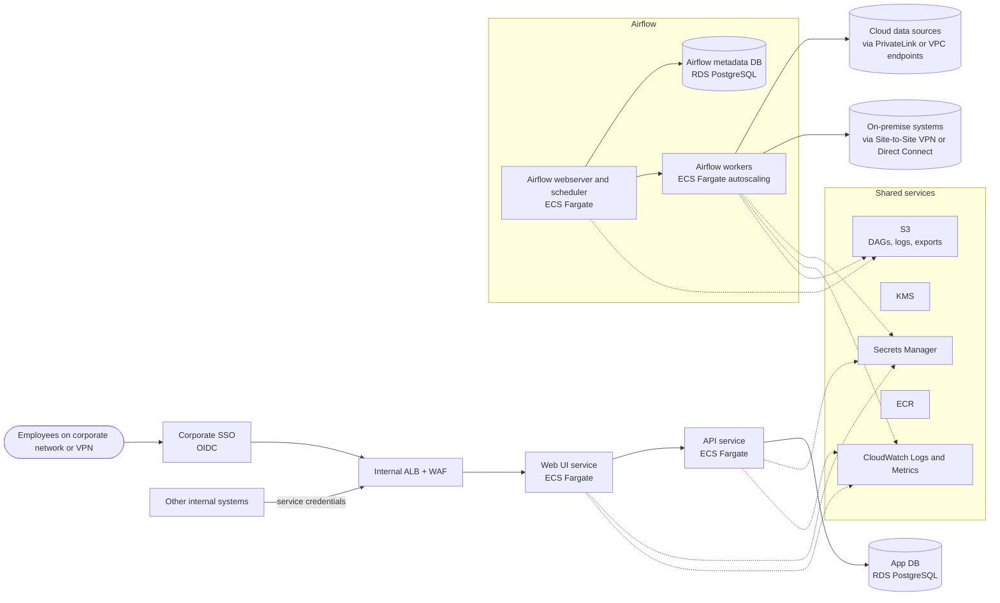
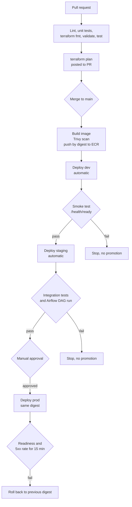

# Platform Engineer Challenge

This repository answers both questions of the platform engineer challenge. Each section below follows the brief: the question, what was expected, and how this repository meets it.

| Question | Topic | Where |
|---|---|---|
| ข้อที่ 1 | Infrastructure for deploying Metabase with PostgreSQL | Terraform at the repo root, and [Question 1](#ข้อที่-1-infrastructure-for-deploying-an-application) |
| ข้อที่ 2 | Architecture and CI/CD pipeline | [Question 2](#ข้อที่-2-architecture-and-cicd-pipeline) |

## Repository layout

```
main.tf, variables.tf, outputs.tf, providers.tf, versions.tf, backend.tf
environments/          per-environment settings (dev, staging, prod) and state backend config
modules/
  network/             VPC, public, private, and database subnets, routing
  database/            RDS PostgreSQL, password in Secrets Manager
  metabase/            ALB, ECS Fargate service, secrets, and access rules
tests/                 root-level tests (terraform test)
```

---

## ข้อที่ 1: Infrastructure for deploying an application

> ให้ผู้สมัครออกแบบและเขียน Infrastructure as Code สำหรับ deploy ระบบ Metabase พร้อมฐานข้อมูล PostgreSQL โดยระบบต้องสามารถเข้าใช้งานผ่าน web ได้จริง

Metabase runs on ECS Fargate behind a public Application Load Balancer. PostgreSQL 16 runs on RDS in subnets with no route to the internet.


### Provision infrastructure with Terraform

> provision infrastructure ด้วย Terraform

All infrastructure is Terraform. Nothing is created by hand except the one-time state bucket. The code is split into three modules, wired together by the root module:

- `network`: VPC (`10.20.0.0/16` in dev), public, private, and database subnets across two availability zones, internet gateway, NAT gateway, and route tables.
- `database`: RDS PostgreSQL 16, its subnet group and security group, and its password in Secrets Manager.
- `metabase`: ALB, ECS Fargate cluster and service, IAM execution role, CloudWatch log group, the Metabase encryption key in Secrets Manager, and the one rule that lets the app reach the database.

Each environment has its own `environments/<env>.tfvars` and `environments/<env>.backend.hcl`. State lives in a versioned S3 bucket with native locking.

### Structure for Metabase and PostgreSQL

> วางโครงสร้างระบบสำหรับ Metabase และฐานข้อมูล PostgreSQL ได้อย่างเหมาะสม

Each tier can reach only what it needs:

| Tier | Subnet | Accepts traffic from |
|---|---|---|
| Application Load Balancer | public | allowed CIDRs on port 80 (and 443 when a certificate is set) |
| Metabase on ECS Fargate | private, no public IP | the ALB only, on port 3000 |
| RDS PostgreSQL | database, no internet route | the Metabase security group only, on port 5432 |

Metabase pulls its image and reads Secrets Manager through one NAT gateway. The load balancer health-checks `/api/health`, the service has a 300-second grace period for Metabase's slow first start, and the ECS deployment circuit breaker rolls back failed deploys.

### PostgreSQL is not reachable from the public network

> ฐานข้อมูล PostgreSQL ต้องไม่สามารถเข้าถึงได้จาก public network โดยตรง

The database is protected in three layers, and each one is tested:

- `publicly_accessible = false`, so RDS never gets a public IP.
- The database subnets' route table has no route to the internet gateway or NAT gateway.
- The database security group allows port 5432 only from the Metabase security group. There is no CIDR rule.

Checked against the live deployment from a laptop outside the VPC:

```
$ dig +short metabase-dev-postgres.<id>.ap-southeast-2.rds.amazonaws.com
10.20.138.248                                   # private address only

$ nc -vz -G 5 metabase-dev-postgres.<id>.ap-southeast-2.rds.amazonaws.com 5432
nc: ... port 5432 (tcp) failed: Operation timed out

$ aws rds describe-db-instances --db-instance-identifier metabase-dev-postgres
"PubliclyAccessible": false, "StorageEncrypted": true, "EngineVersion": "16.13"
```

### Configuration and secrets

> มีการจัดการ configuration และ secret อย่างเหมาะสม

- **Configuration:** non-secret values (instance sizes, task count, image tag, CIDRs) are in `environments/*.tfvars` and reviewed in Git.
- **Database password:** generated by Terraform, stored in Secrets Manager, and injected into the container through the ECS `secrets` block. It never appears as a plain environment variable, and a test enforces that.
- **Metabase encryption key:** generated by Terraform and stored the same way. Metabase uses it to encrypt saved database credentials.
- **Why not RDS-managed passwords:** RDS rotates them every 7 days. Running Metabase tasks would keep the old password and lose database access after each rotation.
- **State:** the generated secrets are in Terraform state, so state is kept in an S3 bucket that is versioned, encrypted, and blocks all public access.
- **Safe defaults:** no ingress is allowed unless an environment lists its CIDRs, and the prod plan fails without an HTTPS certificate.

### Deploy

Prerequisites: Terraform 1.10 or newer, and AWS CLI credentials for the target account. NAT gateway, ALB, Fargate, and Secrets Manager are outside the AWS free tier, so set a budget alert and destroy the stack after testing.

One-time state bucket:

```bash
ACCOUNT_ID=$(aws sts get-caller-identity --query Account --output text)
BUCKET="metabase-tfstate-${ACCOUNT_ID}"
aws s3api create-bucket --bucket "$BUCKET" --region ap-southeast-2 \
  --create-bucket-configuration LocationConstraint=ap-southeast-2
aws s3api put-bucket-versioning --bucket "$BUCKET" --versioning-configuration Status=Enabled
aws s3api put-public-access-block --bucket "$BUCKET" \
  --public-access-block-configuration BlockPublicAcls=true,IgnorePublicAcls=true,BlockPublicPolicy=true,RestrictPublicBuckets=true
```

Set that bucket name in `environments/*.backend.hcl`, then:

```bash
terraform init -backend-config=environments/dev.backend.hcl
terraform plan -var-file=environments/dev.tfvars -out=dev.tfplan
terraform apply dev.tfplan
terraform output app_url
```

Open `app_url` and finish the Metabase setup wizard right away. Until setup is done, anyone who can reach the URL can create the first admin account.

Destroy when finished:

```bash
terraform destroy -var-file=environments/dev.tfvars
```

### Test

```bash
terraform init -backend=false
terraform test
for m in modules/network modules/database modules/metabase; do
  (cd "$m" && terraform init -backend=false && terraform test)
done
```

The tests run offline with mocked providers. 19 tests pass:

| Suite | Result | What it checks |
|---|---|---|
| `modules/network` | 4 passed | subnet layout, no internet route for the database tier, no auto-assigned public IPs |
| `modules/database` | 5 passed | not publicly accessible, encrypted, secret matches the password, dev teardown, prod protection |
| `modules/metabase` | 6 passed | password only via secrets, DB reachable only from app, `/api/health` check, grace period, HTTP and HTTPS listeners |
| root | 4 passed | unknown environment rejected, prod refuses plain HTTP, no ingress by default, valid environment plans |

Two security properties were also broken on purpose to confirm the tests catch them: a public database and a plain-text password. Both failed their tests, and both were restored.

### Result of the live deployment

Deployed to `dev` in `ap-southeast-2` on 11 Oct 2026, then destroyed:

- `terraform apply`: 46 resources added.
- `GET /api/health` through the ALB: HTTP 200, `{"status":"ok"}`. The Metabase welcome page loaded in a browser.
- Database: private address only, connection from outside the VPC timed out, `PubliclyAccessible: false`, `StorageEncrypted: true`.
- `terraform destroy`: 46 resources destroyed. No load balancer, NAT gateway, or database remains.

### Deliverables

> เอกสารหรือไฟล์ที่ต้องส่ง: Terraform code, README

- Terraform code: the `*.tf` files, [`modules/`](modules/), [`environments/`](environments/), and [`tests/`](tests/) at the repo root
- README: this file

---

## ข้อที่ 2: Architecture and CI/CD pipeline

> สมมติว่าบริษัทต้องการพัฒนาระบบ web application ภายในองค์กร ... ประกอบด้วยหลาย service ทั้งส่วนที่ให้บริการผู้ใช้งานผ่านหน้าเว็บ ส่วนที่ให้บริการเชื่อมต่อผ่าน API และส่วนที่เป็นงานเบื้องหลังของระบบ (เช่น Apache Airflow) ... รองรับการแยก environment เป็น dev / staging / prod และอาจต้องเชื่อมต่อออกไปยังระบบหรือฐานข้อมูลภายนอก ซึ่งอาจอยู่บน cloud หรือ on-premise

### System architecture

> อธิบายภาพรวมของสถาปัตยกรรมระบบได้อย่างเหมาะสม

The platform is for employees only. Users reach it from the corporate network or VPN and sign in with corporate SSO. Nothing is on a public load balancer.



- **Web UI and API:** ECS Fargate services in private subnets behind an internal ALB with WAF. Other internal systems call the API with service credentials.
- **Background work:** Airflow webserver and scheduler, autoscaling workers, and a separate metadata database.
- **Data:** the application database is RDS PostgreSQL in database subnets.
- **External systems:** cloud sources through PrivateLink or VPC endpoints; on-premise systems through Site-to-Site VPN or Direct Connect, attached to a Transit Gateway.
- **Shared services:** Secrets Manager, KMS, CloudWatch, ECR, and S3.

The building blocks are the same as Question 1 (Fargate, RDS in database subnets, Secrets Manager). The difference is the internal ALB and SSO.

### Environments and deployment

> อธิบายแนวทางการแบ่ง environment และการ deploy ทั้ง application และ infrastructure ในแต่ละ environment

- **One AWS account per environment** (dev, staging, prod) under AWS Organizations, for separate permissions and billing.
- **Non-overlapping VPC CIDRs:** dev `10.20.0.0/16`, staging `10.21.0.0/16`, prod `10.30.0.0/16`. No peering between environments.
- **Infrastructure:** one Terraform code base for all environments, with per-environment `*.tfvars` and state, as in Question 1. Changes go to dev, then staging, then prod.
- **Application:** each service builds one image. The same image digest is promoted through every environment, so nothing is rebuilt between staging and prod.

| Environment | Size | Deploy | Approval |
|---|---|---|---|
| dev | 1 task per service, small database | automatic on merge to `main` | none |
| staging | prod topology at lower scale | automatic after dev smoke test passes | none |
| prod | 2+ tasks per service across 2 AZs, Multi-AZ database | manual, from a staging-verified digest | two reviewers |

### Configuration, secrets, and external connections

> อธิบายแนวทางการจัดการ configuration, secret และการเชื่อมต่อกับระบบภายนอก

- **Configuration:** non-secret values in `*.tfvars` and task definition environment variables, reviewed in pull requests.
- **Secrets:** stored in Secrets Manager and read at runtime through the ECS `secrets` block or Airflow's Secrets Backend. Never in images, task definitions, or Git.
- **External credentials:** one per data source, least privilege, rotated on a schedule. Rotation restarts tasks so they pick up the new value.
- **CI access:** GitHub Actions assumes a per-environment IAM role through OIDC. No long-lived keys.
- **Cloud sources:** PrivateLink or VPC endpoints, so traffic stays off the public internet.
- **On-premise sources:** Site-to-Site VPN with two tunnels through a Transit Gateway, routed only to the subnets Airflow workers need.
- **Egress:** an allowlist per DAG. External firewalls allow only the NAT egress IPs.
- **Encryption:** RDS storage is encrypted with KMS. Production must also require TLS on database connections (`rds.force_ssl`).

### Keeping the system stable in production

> อธิบายแนวทางการดูแลเสถียรภาพของระบบเมื่อใช้งานจริง ทั้งในด้านการป้องกัน การเฝ้าระวัง และการรับมือเมื่อเกิดปัญหา เช่น monitoring, logging, health check และ alerting

**Prevention.** WAF managed rules on the ALB, rate limits on the API, at least two tasks per service across two AZs in prod, autoscaling on CPU and Airflow queue depth, and retries and timeouts on Airflow tasks so one slow source can't block the scheduler.

**Health checks.** Every service exposes `/health/live` (process is up) and `/health/ready` (dependencies such as the database are reachable). The ALB routes on readiness. ECS restarts tasks that fail liveness. A separate alarm watches the Airflow scheduler heartbeat.

**Monitoring.** One CloudWatch dashboard per service: request rate, error rate, and latency (p50, p95, p99) for web and API; scheduler heartbeat, DAG duration, task failure rate, and queue depth for Airflow; CPU, connections, and free storage for databases.

**Logging.** Structured JSON logs to CloudWatch Logs, with a request ID carried across services. Retention is 30 days in dev and staging and 90 days in prod. Secrets and personal data are redacted.

**Alerting.** On-call is paged for a sustained 5xx rate (5 minutes), readiness failing on every task of a service, a missing scheduler heartbeat (5 minutes), or database free storage under 15%. A ticket is raised for high DAG failure rates and certificates expiring within 30 days. Every alarm links to a runbook.

**Incident response.** Severity levels SEV1 to SEV3 with response times (SEV1 within 15 minutes, 24x7). On-call rotation. Status updates to users every 30 minutes during SEV1 and SEV2. Blameless post-incident review within 5 working days.

**Recovery.** Automated backups with point-in-time recovery, prod snapshots copied to a second region, and a restore drill every quarter. Targets: RPO 5 minutes; RTO 1 hour for web and API, 4 hours for Airflow.

### Promotion and release between dev, staging, and prod

> อธิบายแนวทางการ promote หรือ release ระหว่าง dev / staging / prod

There is one pipeline per deployable unit: web UI, API, Airflow image (DAGs are baked in), and Terraform.



- **Pull request:** lint, unit tests, `terraform fmt`, `validate`, and `test`, with the `terraform plan` posted to the PR.
- **Merge:** build the image, scan with Trivy (critical issues with a fix block the pipeline), push to ECR by digest.
- **Dev and staging:** deploy automatically, then run a smoke test in dev and integration tests plus an Airflow DAG run in staging. A failure stops promotion.
- **Prod:** manual approval, then deploy the same digest. If readiness or the 5xx rate fails within 15 minutes, roll back automatically.
- **Database migrations:** expand-then-contract, run as a one-off task before the service rolls out, and always compatible with the previous version so rollback is safe.
- **Rollback:** redeploy the previous digest for applications; revert the commit for infrastructure. No console changes.
- **Drift:** a daily `terraform plan` per environment raises an alert if anything changed outside Terraform.

### Deliverables

> เอกสารหรือไฟล์ที่ต้องส่ง: Architecture diagram, Flow ของ CI/CD pipeline, README

- Architecture diagram: [System architecture](#system-architecture)
- CI/CD flow: [Promotion and release](#promotion-and-release-between-dev-staging-and-prod)
- README: this file

---

## Assumptions

- **Cloud:** AWS, region `ap-southeast-2` (Sydney). The Singapore region (`ap-southeast-1`) is blocked for the test account by an organization policy.
- **Network:** one NAT gateway, for cost. Production should use one per availability zone.
- **TLS:** HTTP by default. Setting `certificate_arn` enables HTTPS, and the prod plan fails without it.
- **Ingress:** no CIDRs are allowed by default. Dev allows `0.0.0.0/0` so a reviewer can open it. Staging and prod use the placeholder `203.0.113.0/24`, which must be replaced before applying.
- **Image:** the public `metabase/metabase` image, pinned to `v0.64.1`. `latest` is never used.
- **Database:** Metabase uses the RDS master user. Production should use a least-privilege application user.
- **Environments:** for this challenge, all three share one state bucket with separate keys. In a real organization each would be its own AWS account, as in Question 2.

## Known gaps

- No WAF or HTTPS in dev, and no automated end-to-end test against a live stack.
- Rotation of the database password is designed but not implemented.
- Question 2 is a design. No CI workflow files are committed.
- Only `dev` was deployed, then destroyed to control cost. Staging and prod use the same code with different settings.
