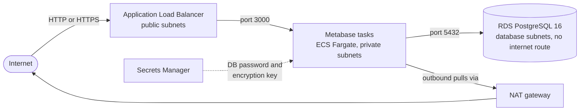

# Platform Engineer Challenge

This repository contains two parts of the platform engineer challenge:

1. **Part 1: Infrastructure as Code.** Terraform that deploys Metabase on AWS with a PostgreSQL database that is not reachable from the public internet. See [Part 1](#part-1-deploy-metabase-with-terraform).
2. **Part 2: Architecture and CI/CD design.** A design for an internal, multi-service web platform with dev, staging, and prod environments:
   - [`docs/architecture.md`](docs/architecture.md): architecture diagram, environments, configuration and secrets, external connections, and production stability.
   - [`docs/cicd.md`](docs/cicd.md): CI/CD pipeline flow, promotion between environments, migrations, and rollback.

The implementation plan this work followed is in [`docs/superpowers/plans/`](docs/superpowers/plans/).

## Repository layout

```
terraform/
  main.tf, variables.tf, outputs.tf, providers.tf, versions.tf, backend.tf
  environments/        per-environment settings and state backend config
  modules/
    network/           VPC, public, private, and database subnets, routing
    database/          RDS PostgreSQL, password in Secrets Manager
    metabase/          ALB, ECS Fargate service, secrets, and access rules
  tests/               root-level tests (terraform test)
docs/
  architecture.md      Part 2: architecture
  cicd.md              Part 2: CI/CD and release flow
  superpowers/plans/   implementation plan
```

## Part 1: Deploy Metabase with Terraform

### Architecture



### Prerequisites

- Terraform 1.10 or newer
- AWS CLI with credentials for the target account
- Budget: NAT gateway, ALB, Fargate, and Secrets Manager are not covered by the AWS free tier. Leaving the stack running costs roughly $60 to $90 per month. Set a budget alert and destroy the stack after testing.

### One-time state bucket

```bash
ACCOUNT_ID=$(aws sts get-caller-identity --query Account --output text)
BUCKET="metabase-tfstate-${ACCOUNT_ID}"
aws s3api create-bucket --bucket "$BUCKET" --region ap-southeast-1 \
  --create-bucket-configuration LocationConstraint=ap-southeast-1
aws s3api put-bucket-versioning --bucket "$BUCKET" --versioning-configuration Status=Enabled
aws s3api put-public-access-block --bucket "$BUCKET" \
  --public-access-block-configuration BlockPublicAcls=true,IgnorePublicAcls=true,BlockPublicPolicy=true,RestrictPublicBuckets=true
```

Put the bucket name into `terraform/environments/*.backend.hcl` in place of `REPLACE_WITH_ACCOUNT_ID`.

### Deploy

```bash
cd terraform
terraform init -backend-config=environments/dev.backend.hcl
terraform plan -var-file=environments/dev.tfvars -out=dev.tfplan
terraform apply dev.tfplan
terraform output app_url
```

Open `app_url` and complete the Metabase setup wizard right away. Until setup is complete, anyone who can reach the URL can create the first admin account.

### Test

```bash
cd terraform
terraform init -backend=false
terraform test
for m in modules/network modules/database modules/metabase; do
  (cd "$m" && terraform init -backend=false && terraform test)
done
```

All tests run offline using mocked AWS and random providers. They check:

- The database is not publicly accessible, is encrypted, and holds the same password as the secret Metabase reads.
- The database accepts traffic only from the Metabase security group, on port 5432.
- `MB_DB_PASS` is injected only from Secrets Manager, never as a plain environment variable.
- The load balancer health-checks `/api/health`, and the service has a 300-second grace period.
- HTTPS and redirects are created only when a certificate is supplied.
- An unknown environment name is rejected.
- Production refuses to run without HTTPS.
- With no CIDRs configured, the load balancer accepts no traffic.

### Verify the private database

```bash
DB_HOST="$(terraform output -raw db_address)"
dig +short "$DB_HOST"                  # resolves to a private 10.x address only
nc -vz -G 5 "$DB_HOST" 5432            # must fail or time out from outside the VPC
aws rds describe-db-instances --query 'DBInstances[?starts_with(DBInstanceIdentifier, `metabase-dev`)].PubliclyAccessible'  # [false]
```

### Destroy

```bash
terraform destroy -var-file=environments/dev.tfvars
```

### Secrets and state

- **Database password:** generated by Terraform and stored in Secrets Manager. ECS injects it into the container through the `secrets` block.
- **Metabase encryption key:** generated by Terraform and stored in Secrets Manager. It encrypts saved database credentials inside Metabase.
- **Why not RDS-managed passwords:** RDS rotates managed master passwords every 7 days. Running Metabase tasks keep the old password and lose database access after rotation. Terraform-managed secrets avoid that, at the cost of a rotation process that restarts tasks.
- **State contains secrets.** The generated values are stored in Terraform state. State is kept in an S3 bucket that is versioned, encrypted, and blocks public access.

## Assumptions

- **Cloud:** AWS, region `ap-southeast-1`, chosen as the nearest region to Bangkok.
- **Network:** one NAT gateway, for cost. Production should use one per availability zone.
- **TLS:** HTTP by default. Set `certificate_arn` to serve HTTPS. Production refuses to plan without it.
- **Ingress:** no CIDRs are allowed by default. Each environment sets its own. Dev is open to `0.0.0.0/0` for the challenge reviewer and should be destroyed after review. Staging and prod use the placeholder `203.0.113.0/24`, which must be replaced before applying.
- **Image:** the public `metabase/metabase` Docker Hub image, pinned by tag. `latest` is never used.
- **Database:** PostgreSQL 16, with the master user used by Metabase. Production should add a least-privilege application user.
- **Environments:** all three share one state bucket with separate keys. In a real organization each would be its own AWS account.

## Known gaps

- Part 1 is a challenge deployment, not production. It has no WAF, no HTTPS in dev, and no automated end-to-end test against a live stack.
- Secret rotation for the database password is designed but not implemented.
- The Part 2 designs describe pipelines and operations; no workflow files are committed.
- Only `dev` was deployed, then destroyed to stay within budget. Staging and prod share the same code with different settings.
- Part 1 exposes Metabase on a public load balancer so reviewers can open it. Part 2 describes an internal-only design, as the brief calls for.

## Verification evidence

Terraform tests (offline):

| Suite | Result |
|---|---|
| `modules/network` | 4 passed, 0 failed |
| `modules/database` | 5 passed, 0 failed |
| `modules/metabase` | 6 passed, 0 failed |
| root | 4 passed, 0 failed |

Mutation checks: I broke two security properties on purpose to confirm the tests catch them. A publicly accessible database fails `database_is_never_publicly_accessible`. A plain-text `MB_DB_PASS` fails `db_password_is_only_injected_as_a_secret`. Both were restored afterwards.

Live deployment: **pending.** This section will be updated with the `curl` health check, screenshot, private-database checks, and destroy confirmation once the dev stack is deployed with AWS credentials.
